# DNA/RNA as a language: steps 1–3

This report explores sequences, words, and their numeric representations. Class labels are used for descriptive tables and chart colours only. No disease-class prediction model is trained.

## The input

- Sequences analysed: 10000
- Alphabet: DNA
- Class counts: pathogenic = 5000, nonpathogenic = 5000
- Length range: 250 to 250 letters
- Sequences with unknown letters: 2594
- Duplicate input rows removed: 0

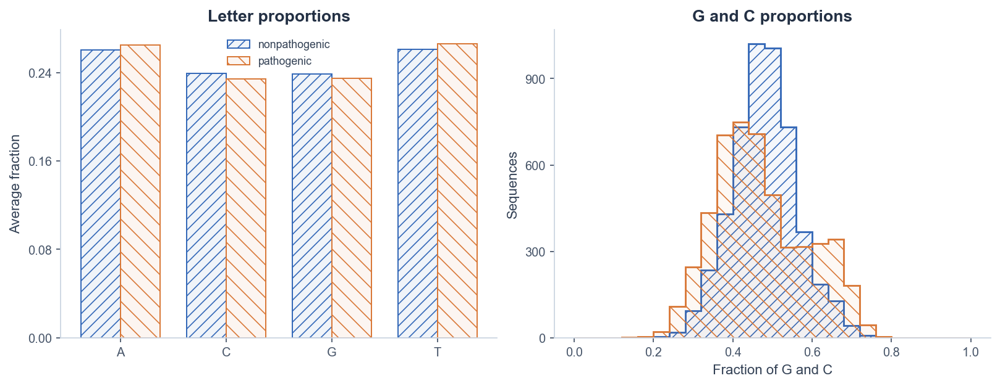

GC fraction means the proportion of known letters that are G or C. Unknown letters remain in the sequence, but words containing them are skipped. Words on opposite sides of an unknown letter do not become neighbours during learning.

## Comparing word sizes

Words overlap: ATGCA produces ATG, TGC, and GCA for size 3. Longer words describe more specific patterns, but each individual sequence contains a smaller fraction of the possible vocabulary.

| Word size | Words observed | Possible words | Total occurrences | Single-occurrence words | Empty sequences |
| --- | --- | --- | --- | --- | --- |
| 3 | 64 | 64 | 2470966 | 0 | 0 |
| 4 | 256 | 256 | 2458044 | 0 | 0 |
| 6 | 4096 | 4096 | 2432340 | 0 | 0 |

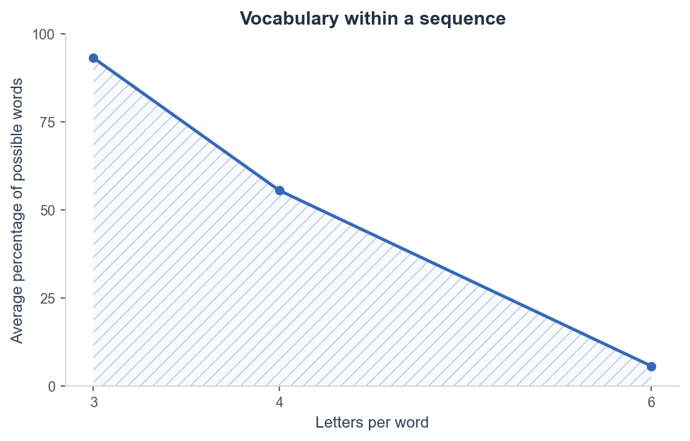

## How sequences become numbers

1. **Bag-of-Words** counts occurrences of each word. Word order is discarded.
2. **TF-IDF** gives larger weight to words occurring in fewer sequences, then scales each sequence's weights to comparable size. It also discards word order.
3. **Word2Vec** learns word vectors by trying to distinguish observed neighbours from randomly chosen words. Class labels are never given to this learning process.
4. **Whole-sequence vectors** average the word vectors, either counting every occurrence equally or weighting distinct words by TF-IDF. Both averages discard the final sequence's word order.

The charts reduce these representations to two coordinates. Nearby points have similar projected representations. The percentage in each chart describes how much variation is shown; the remaining variation is not visible. Apparent groups are exploratory observations, not evidence that a classifier works.

## 3-letter words

- Most common word: TTT (69453 occurrences)
- Least common observed word: CTA (19947 occurrences)
- Windows skipped because they contain unknown letters: 9034
- Average distinct words per sequence: 59.6

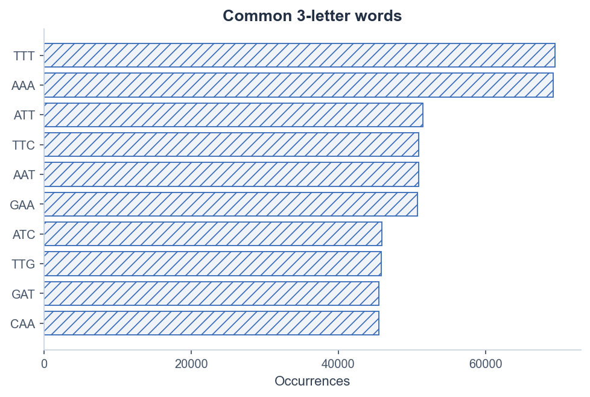

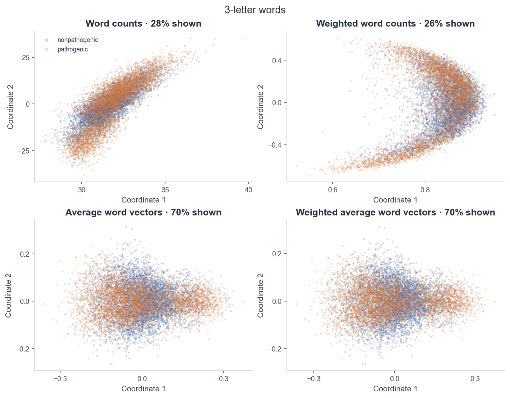

### Do similar surroundings produce similar word vectors?

We count neighbouring words around a random sample of sequences, compare these surroundings for word pairs, and compare their learned vectors. The rank correlation ranges from -1 to 1: positive values mean more similar surroundings tend to accompany more similar learned vectors. A shuffled comparison assigns learned vectors to random words as a reference.

| Surroundings examined | Word pairs | Rank correlation | Shuffled reference |
| --- | --- | --- | --- |
| Nearby words | 2016 | 0.613 | -0.033 |
| Words sharing no sequence positions | 2016 | 0.335 | -0.025 |

The second comparison excludes overlapping neighbours and uses a wider neighbourhood. It helps inspect the effect of shared letters; it is a diagnostic, not a proof of biological meaning. See [nearest words](k_3/nearest_words.csv), [common words](k_3/common_words.csv), and [rare observed words](k_3/rare_words.csv).

## 4-letter words

- Most common word: TTTT (23878 occurrences)
- Least common observed word: CTAG (1738 occurrences)
- Windows skipped because they contain unknown letters: 11956
- Average distinct words per sequence: 142.0

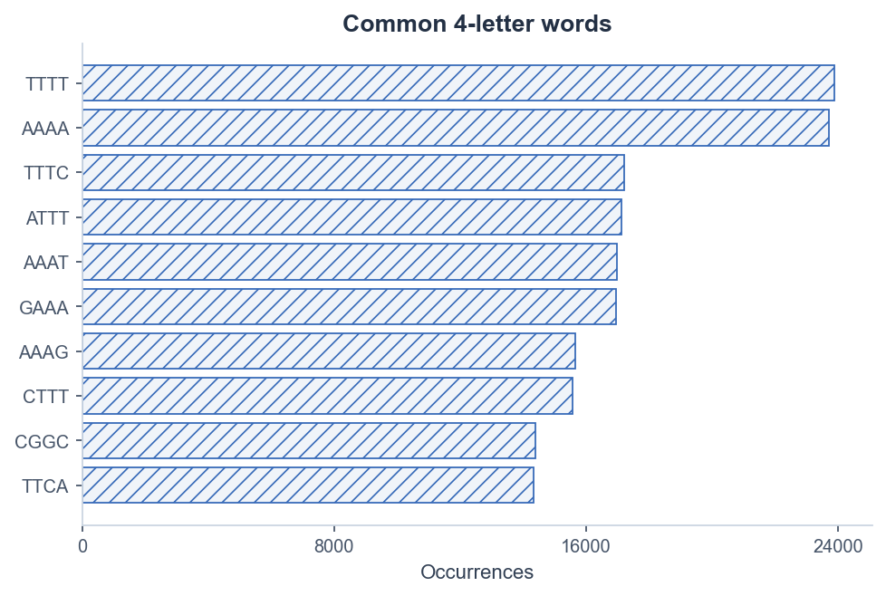

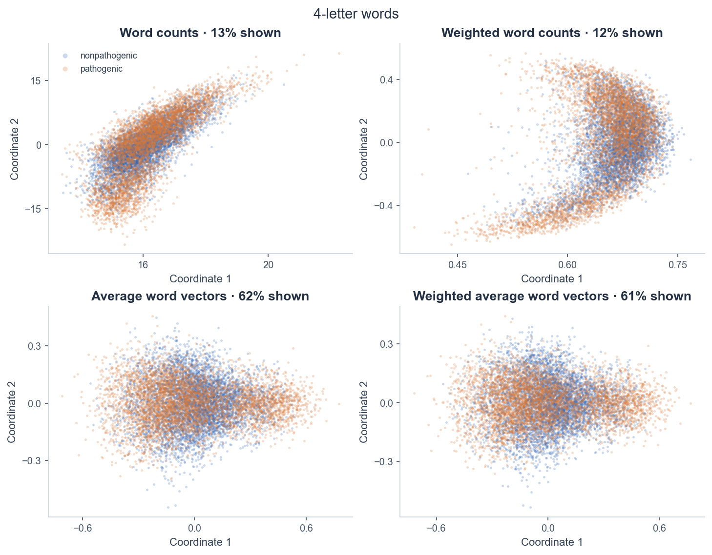

### Do similar surroundings produce similar word vectors?

We count neighbouring words around a random sample of sequences, compare these surroundings for word pairs, and compare their learned vectors. The rank correlation ranges from -1 to 1: positive values mean more similar surroundings tend to accompany more similar learned vectors. A shuffled comparison assigns learned vectors to random words as a reference.

| Surroundings examined | Word pairs | Rank correlation | Shuffled reference |
| --- | --- | --- | --- |
| Nearby words | 3000 | 0.669 | -0.034 |
| Words sharing no sequence positions | 3000 | 0.272 | -0.008 |

The second comparison excludes overlapping neighbours and uses a wider neighbourhood. It helps inspect the effect of shared letters; it is a diagnostic, not a proof of biological meaning. See [nearest words](k_4/nearest_words.csv), [common words](k_4/common_words.csv), and [rare observed words](k_4/rare_words.csv).

## 6-letter words

- Most common word: TTTTTT (2400 occurrences)
- Least common observed word: CCTAGG (53 occurrences)
- Windows skipped because they contain unknown letters: 17660
- Average distinct words per sequence: 229.3

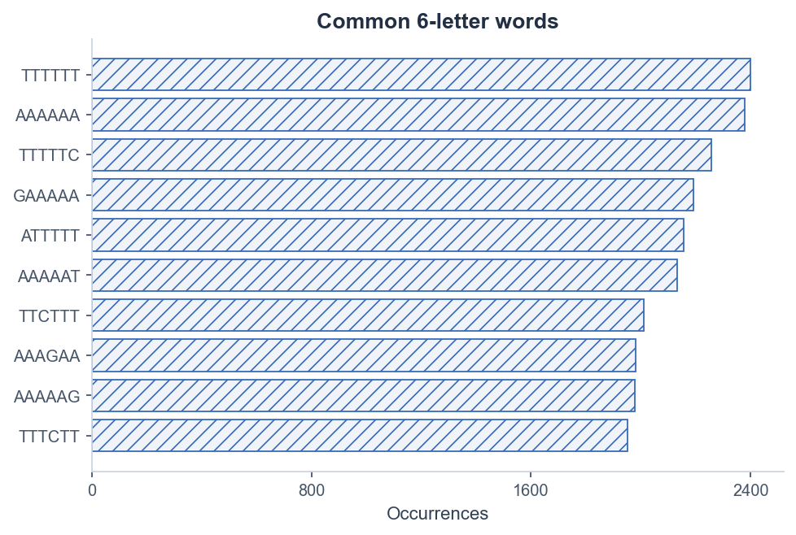

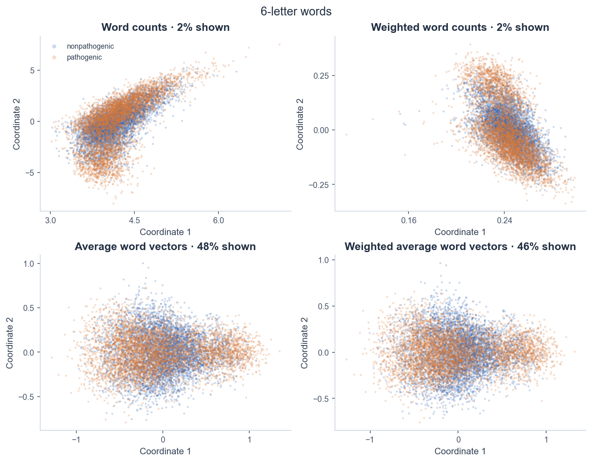

### Do similar surroundings produce similar word vectors?

We count neighbouring words around a random sample of sequences, compare these surroundings for word pairs, and compare their learned vectors. The rank correlation ranges from -1 to 1: positive values mean more similar surroundings tend to accompany more similar learned vectors. A shuffled comparison assigns learned vectors to random words as a reference.

| Surroundings examined | Word pairs | Rank correlation | Shuffled reference |
| --- | --- | --- | --- |
| Nearby words | 3000 | 0.629 | 0.023 |
| Words sharing no sequence positions | 3000 | 0.332 | 0.002 |

The second comparison excludes overlapping neighbours and uses a wider neighbourhood. It helps inspect the effect of shared letters; it is a diagnostic, not a proof of biological meaning. See [nearest words](k_6/nearest_words.csv), [common words](k_6/common_words.csv), and [rare observed words](k_6/rare_words.csv).

## A closer look at the patterns

### How concentrated are word frequencies?

This curve starts with the most common words and adds progressively rarer words. A curve above the diagonal means some words contribute more occurrences than others. Each word size uses its own observed vocabulary. This is a descriptive comparison, not a fitted law of language.

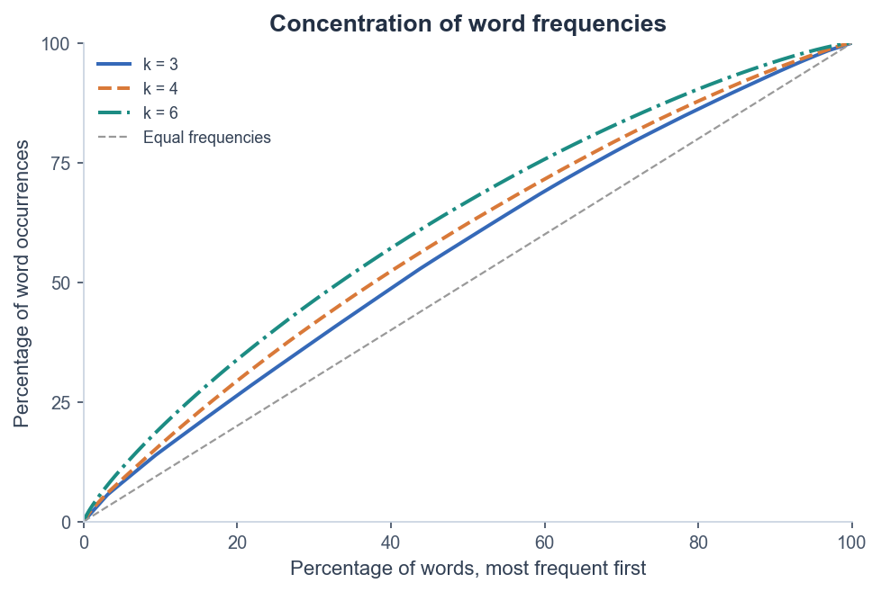

| Word size | Words in the top group | Share of all occurrences |
| --- | --- | --- |
| 3 | 7 of 64 | 15.7% |
| 4 | 26 of 256 | 16.3% |
| 6 | 410 of 4096 | 19.6% |

The top group contains the most frequent 10% of observed words, rounded up to a whole word. See [frequency concentration](frequency_concentration.csv) and each word-size directory's `frequency_ranks.csv`.

### What explains the visible grouping?

These are the existing average-word-vector coordinates, now coloured by each sequence's proportion of G and C. Sequences with no usable words or no known letters are excluded. A colour gradient along a coordinate shows an association with letter composition.

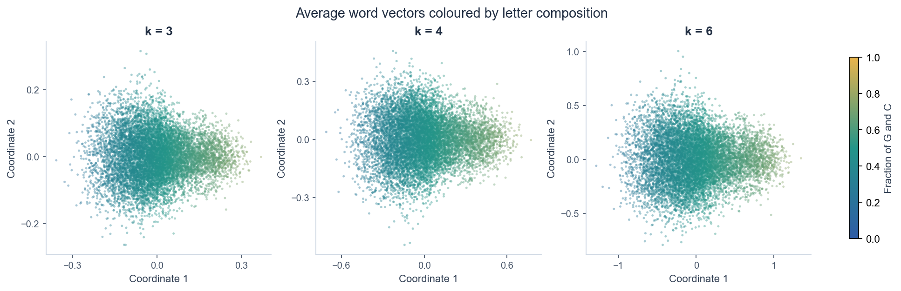

| Word size | G/C agreement with coordinate 1 | G/C agreement with coordinate 2 |
| --- | --- | --- |
| 3 | 0.997 | -0.008 |
| 4 | 0.996 | -0.013 |
| 6 | 0.996 | 0.008 |

These are rank correlations from -1 to 1. A magnitude near 1 indicates a strong association. Projection directions can flip, so the sign does not carry a biological meaning. Strong agreement suggests composition is a major feature of that coordinate, but does not show that composition explains every difference. All four representations are checked in [composition correlations](composition_correlations.csv). No significance test or disease accuracy is reported.

### Which words differ between the source classes?

The figure compares 4-letter word rates in pathogenic versus nonpathogenic. Each rate divides by the total usable word occurrences in its class. A ratio of 2 means twice the relative frequency; 0.5 means half. Up to six words in each direction are shown, requiring at least 20 occurrences in each class. Ratios use a 0.5-count adjustment to handle zero counts in the full table.

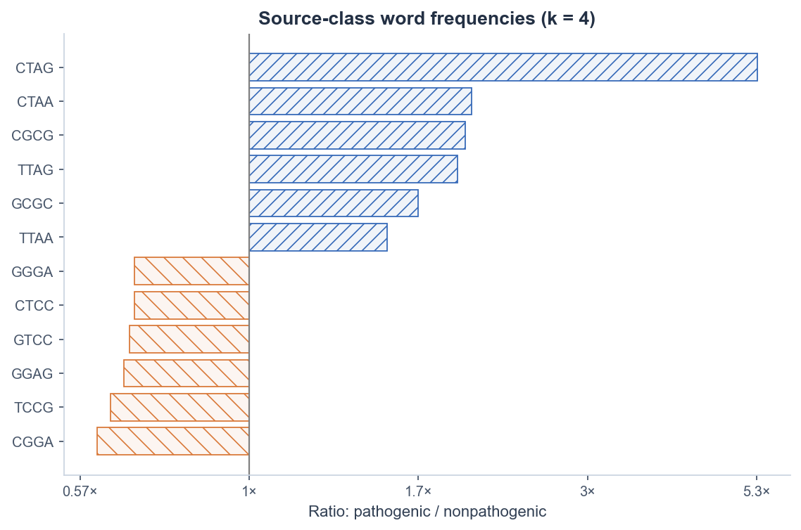

These are descriptive differences in the same sample. They can reflect source species or letter composition and do not identify disease-causing words. Counts include overlapping windows and are not independent observations. See `k_4/class_word_comparison.csv` for all words and `class_words_shown.csv` for the plotted selection.

### Does letter order affect the observed words?

We shuffle letters independently inside every uninterrupted known-letter run, repeat this for the full dataset 10 times, and count 4-letter words each time. Sequence lengths, letter counts within each run, unknown-letter gaps and the number of usable windows stay fixed. No new Word2Vec model is trained for this check. The comparison uses size 4 when available, otherwise the closest completed size up to 6.

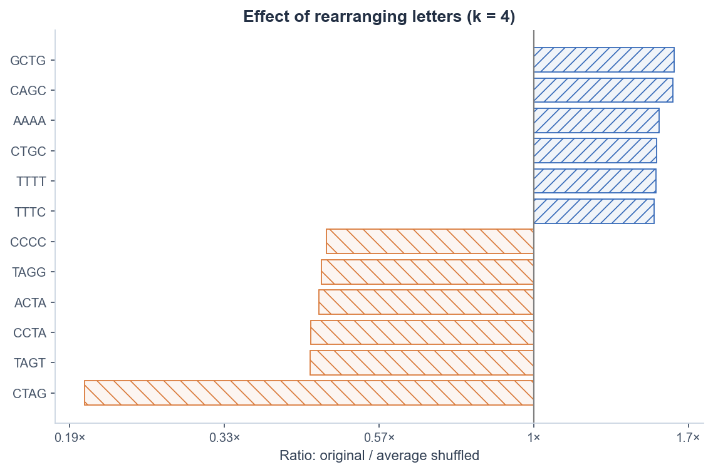

Ratios compare the original count with the mean shuffled count, using a 0.5-count adjustment. Up to six words in each direction are shown, requiring at least 20 original and 20 average shuffled occurrences. Values above 1 indicate more occurrences in the original order, and values below 1 indicate fewer. The saved table also includes variation and the observed range across shuffles. Ten shuffles provide an exploratory reference, not a confidence interval or a significance test. The extremes shown are selected from the same data and do not establish a biological function. See `k_4/shuffled_word_comparison.csv` and `shuffled_words_shown.csv` when a figure is available.

## Interpretation limits

- Overlapping words share letters by construction. Similar word vectors alone do not demonstrate that the computer has learned biological grammar.
- Class differences can reflect species, letter composition, or sequence length. These charts do not establish the cause of a difference.
- Zero vectors indicate sequences with no usable words for that word size. They have no learned representation and may coincide in a chart.
- Rare-word tables include words actually observed. Words absent from the sample are counted in vocabulary coverage, not listed as observed rare words.
- The context comparisons use at most 200 randomly selected sequences and 256 frequent words. One shuffled reference is an exploratory comparison, not a statistical significance test.
- DeePaC supplies simulated 250-letter reads from bacterial genomes. The source organisms carry the labels; individual fragments do not necessarily cause disease.
- The prepared sample uses the published validation files for this exploratory work. The published test files remain unused. If the project later grows to step 4, use the published training data for learning and reserve untouched test data for the final evaluation.
- The sample is balanced by class, not by bacterial species. Repeated sequences are checked within sampled candidates, not across every source genome.

Source: [DeePaC dataset](https://zenodo.org/records/3678563), [research paper](https://doi.org/10.1093/bioinformatics/btz541).

## Saved files

Each word-size directory contains the full frequency tables, per-sequence word statistics, four numeric sequence representations, word vectors, word neighbours, context comparisons, and chart coordinates. `row_ids.csv` gives the sequence order; `vocabulary.json` gives the column or word-vector order. `summary.json` records settings, fingerprints, software versions, and projection information.

Runtime on this machine: 77.2 seconds, excluding dataset preparation.
