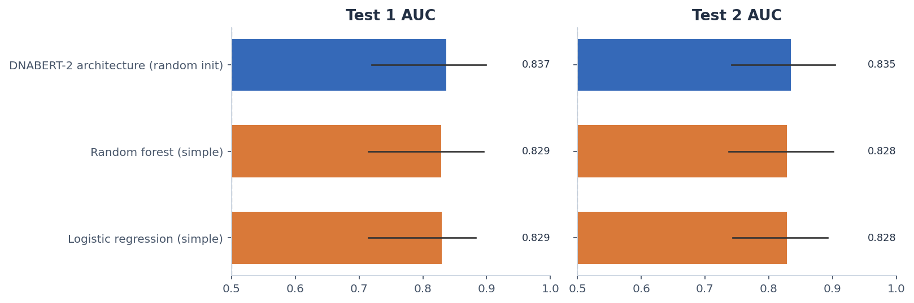
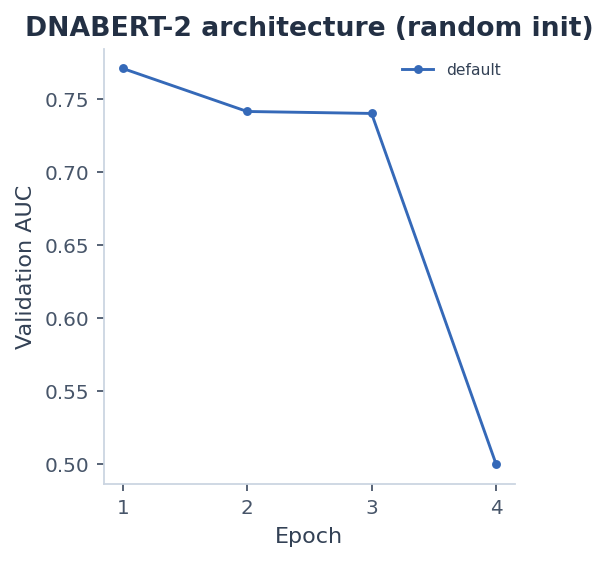

# Task 4: neural models on DeePaC train, validation, and test reads

The grid setting and the stopping epoch are chosen on validation reads only, and the test sets are scored once, for the validation-chosen setting. All splits come from different genomes.

## Data

- Reads per class: train = 1000000, val = 50000, test_1 = 100000, test_2 = 100000
- Genomes per split: train = 355, val = 45, test_1 = 45, test_2 = 45
- Test read pairing: {"test_1_reads": 200000, "test_2_reads": 200000, "reads_in_both": 123639}
- Seeds: 42
- Device: cuda

## Models ranked by validation AUC

The intervals resample whole genomes within each class; their bounds are averaged over seeds. The control rows train the CNN on shuffled training labels and should sit near 0.5.

| Model | Representation | k | Parameters | Val AUC | Test 1 AUC | Test 1 95% interval | Test 2 AUC | Train AUC |
| --- | --- | --- | --- | --- | --- | --- | --- | --- |
| dnabert2_scratch | bpe_tokens_random_init | n/a | 117069313 | 0.771 | 0.837 | 0.720–0.898 | 0.835 | 0.836 |

## Best simple models, for comparison

From `simple_models/results_summary.csv`, ranked the same way.

| Model | Representation | k | Val AUC | Test 1 AUC | Test 2 AUC |
| --- | --- | --- | --- | --- | --- |
| random_forest | counts | 4 | 0.788 | 0.829 | 0.828 |
| logistic_regression | weighted_vectors | 4 | 0.788 | 0.829 | 0.828 |
| logistic_regression | counts | 3 | 0.786 | 0.828 | 0.827 |

The complete tables are `results_summary.csv` (averaged over seeds), `results.csv` (every seed), `tuning.csv` (every setting tried, validation only) and `history.csv` (every epoch).

## Figures

## How to read these results

- Labels describe the source bacteria, not whether a read causes disease.
- test_1 and test_2 are the two mate reads of the same fragments, so they are two views of one test, not independent replicates.
- The CNN, GRU and transformer see each read on both strands: strands are flipped at random while training and the two scores are averaged when predicting.
- The mean-pooled word-vector rows of the simple models and the GRU share the same Word2Vec vectors, learned from training reads only.
- Selecting the best row by test score would be tuning on the test set; use the validation ranking.
- GPU training is not bit-for-bit repeatable, so reruns of the same seed can differ slightly. Seeds are for spread, not exact reproduction.
- A gap between train and validation AUC means the network is memorising species-specific reads; the test sets are species the networks never saw.

## Added after the run

- Genome-level metrics and the extra test sets (BacPaCS, 150/100 bp reads, shuffled letters) are in `genome/genome_summary.csv`; cross-model figures are in `../summary/`.
- Validation AUC is noisy (45 genomes) and early epochs are often best, so the stopping epoch and setting choice carry little information.
