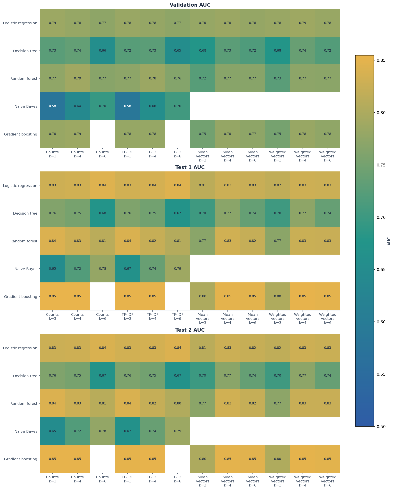
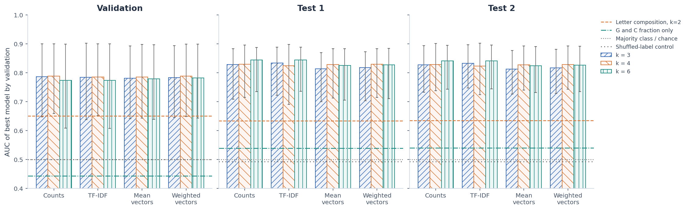
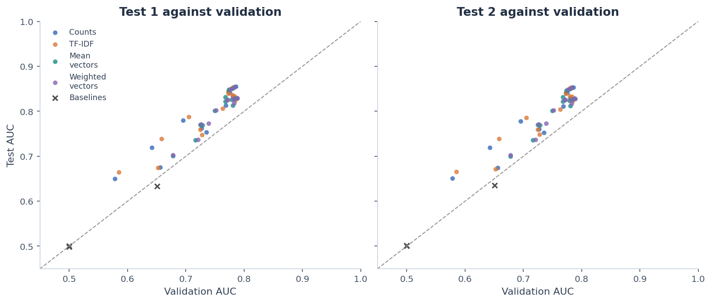

# Task 4: simple models on DeePaC train, validation, and test reads

Representations are learned from the training reads only. Hyperparameters are chosen on the validation reads. The two test sets are scored only for the validation-chosen setting of each model. All splits come from different genomes.

## Data

- Reads per class: train = 1000000, val = 50000, test_1 = 100000, test_2 = 100000
- Genomes per split: train = 355, val = 45, test_1 = 45, test_2 = 45
- Genome overlap between splits (test_1 and test_2 are mates of the same fragments, so they share genomes by design): {"train & val": 0, "train & test_1": 0, "train & test_2": 0, "val & test_1": 0, "val & test_2": 0}
- Test read pairing: {"test_1_reads": 200000, "test_2_reads": 200000, "reads_in_both": 123639}
- Exact repeated reads across splits: {"train & val": 0, "train & test_1": 1, "train & test_2": 0, "val & test_1": 0, "val & test_2": 0, "test_1 & test_2": 17}
- Seeds: 42, 43, 44

## Baselines and controls

Baselines use no word information (majority class), or only letter content. The shuffled-label control trains on randomly reassigned training labels, repeated with five different shuffles. Its average should sit near 0.5 AUC. A single shuffle can land away from 0.5 when one strong direction such as G/C content separates the classes, so read the average and the spread; a consistently high value would signal a leak.

| Group | Name | Val AUC | Test 1 AUC | Test 2 AUC | Test 1 accuracy |
| --- | --- | --- | --- | --- | --- |
| baseline | gc_fraction | 0.443 | 0.539 | 0.540 | 0.559 |
| baseline | ambiguous_letters | 0.499 | 0.499 | 0.501 | 0.499 |
| baseline | composition_k1 | 0.443 | 0.539 | 0.540 | 0.560 |
| baseline | composition_k2 | 0.651 | 0.633 | 0.635 | 0.606 |
| baseline | majority class | 0.500 | 0.500 | 0.500 | 0.500 |
| control | shuffled labels, counts, k=3 | 0.502 | 0.484 | 0.484 | 0.487 |
| control | shuffled labels, tfidf, k=3 | 0.502 | 0.484 | 0.484 | 0.488 |
| control | shuffled labels, mean_vectors, k=3 | 0.503 | 0.504 | 0.504 | 0.503 |
| control | shuffled labels, weighted_vectors, k=3 | 0.502 | 0.503 | 0.503 | 0.503 |
| control | shuffled labels, counts, k=4 | 0.493 | 0.486 | 0.486 | 0.490 |
| control | shuffled labels, tfidf, k=4 | 0.496 | 0.495 | 0.494 | 0.496 |
| control | shuffled labels, mean_vectors, k=4 | 0.511 | 0.494 | 0.494 | 0.494 |
| control | shuffled labels, weighted_vectors, k=4 | 0.509 | 0.493 | 0.492 | 0.493 |
| control | shuffled labels, counts, k=6 | 0.499 | 0.498 | 0.499 | 0.499 |
| control | shuffled labels, tfidf, k=6 | 0.499 | 0.499 | 0.499 | 0.499 |
| control | shuffled labels, mean_vectors, k=6 | 0.490 | 0.484 | 0.484 | 0.487 |
| control | shuffled labels, weighted_vectors, k=6 | 0.489 | 0.484 | 0.484 | 0.487 |

## Models ranked by validation AUC

AUC is the chance that a random pathogenic read scores above a random nonpathogenic one (0.5 is chance). The intervals resample whole genomes within each class, because reads from one genome are not independent; their bounds are averaged over seeds.

| Model | Representation | k | Val AUC | Test 1 AUC | Test 1 95% interval | Test 2 AUC | Train AUC |
| --- | --- | --- | --- | --- | --- | --- | --- |
| random_forest | counts | 4 | 0.788 | 0.829 | 0.715–0.896 | 0.828 | 0.862 |
| logistic_regression | weighted_vectors | 4 | 0.788 | 0.829 | 0.714–0.883 | 0.828 | 0.795 |
| logistic_regression | counts | 3 | 0.786 | 0.828 | 0.708–0.883 | 0.827 | 0.796 |
| gradient_boosting | counts | 4 | 0.786 | 0.855 | 0.755–0.902 | 0.853 | 0.843 |
| random_forest | tfidf | 4 | 0.784 | 0.823 | 0.690–0.897 | 0.823 | 0.886 |
| logistic_regression | mean_vectors | 4 | 0.784 | 0.828 | 0.712–0.882 | 0.827 | 0.794 |
| logistic_regression | tfidf | 3 | 0.784 | 0.833 | 0.722–0.888 | 0.832 | 0.796 |
| logistic_regression | weighted_vectors | 3 | 0.783 | 0.818 | 0.703–0.872 | 0.817 | 0.791 |
| gradient_boosting | counts | 3 | 0.782 | 0.854 | 0.757–0.905 | 0.853 | 0.841 |
| logistic_regression | weighted_vectors | 6 | 0.782 | 0.827 | 0.710–0.883 | 0.826 | 0.794 |
| gradient_boosting | weighted_vectors | 4 | 0.782 | 0.852 | 0.757–0.904 | 0.851 | 0.850 |
| gradient_boosting | tfidf | 4 | 0.781 | 0.853 | 0.747–0.901 | 0.852 | 0.846 |
| logistic_regression | counts | 4 | 0.781 | 0.832 | 0.720–0.879 | 0.829 | 0.815 |
| logistic_regression | mean_vectors | 3 | 0.780 | 0.813 | 0.700–0.869 | 0.813 | 0.790 |
| gradient_boosting | tfidf | 3 | 0.780 | 0.852 | 0.746–0.906 | 0.851 | 0.845 |

The complete tables are `results_summary.csv` (averaged over seeds), `results.csv` (every seed), and `tuning.csv` (every setting tried, validation only).

## Figures

## How to read these results

- Labels describe the source bacteria, not whether a read causes disease.
- test_1 and test_2 are the two mate reads of the same fragments (identical read ids), so they are two views of one test, not independent replicates.
- Compare every model with the letter-composition baselines: performance close to them suggests composition, not word grammar, drives the result.
- Selecting the best row by test score would be a form of tuning on the test set; use the validation ranking.
- Thresholded metrics (accuracy, F1) use a 0.5 cutoff chosen without regard to species shift; AUC does not depend on it.
