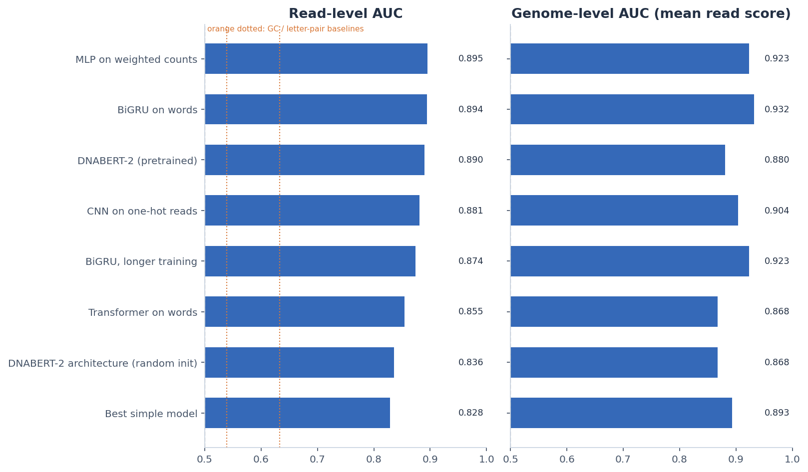
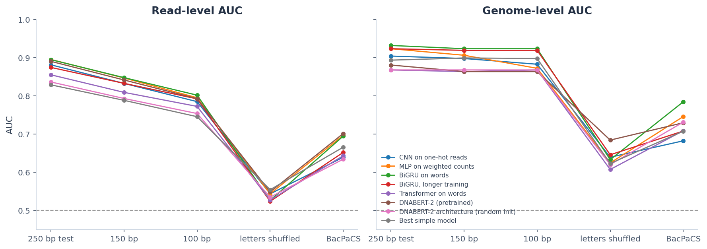
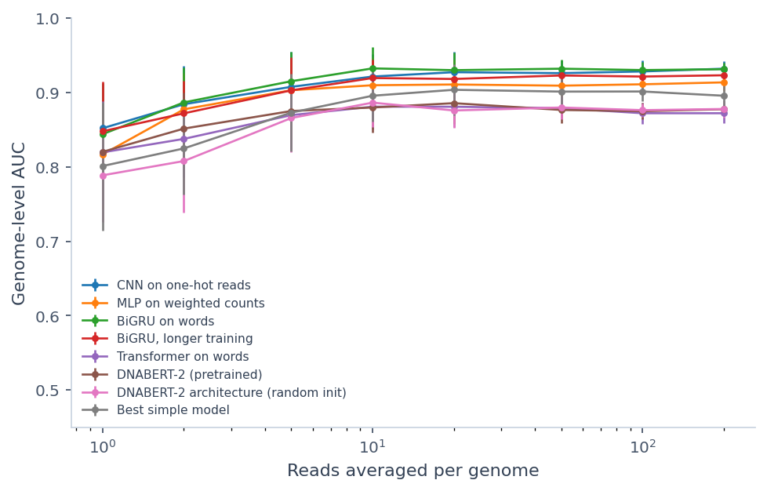
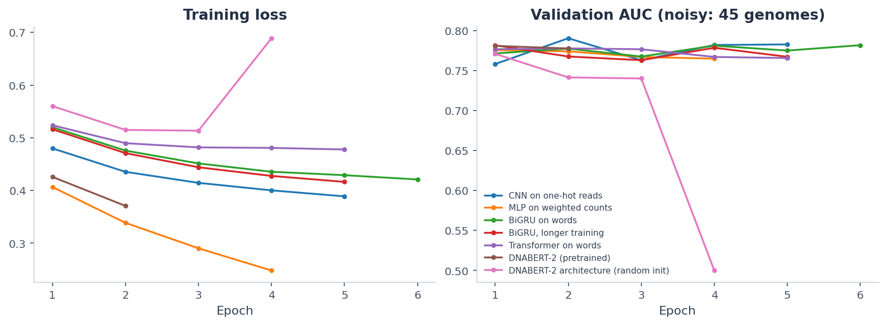

# Task 4: all models, summary

Read-level AUC (best setting by validation AUC, mean over seeds). `simple` is the best simple model.

| model | test_pooled | test_1_len150 | test_1_len100 | test_1_letters_shuffled | bacpacs_test_1 |
| --- | --- | --- | --- | --- | --- |
| cnn | 0.881 | 0.832 | 0.785 | 0.543 | 0.639 |
| dnabert2 | 0.89 | 0.841 | 0.792 | 0.548 | 0.701 |
| dnabert2_scratch | 0.836 | 0.793 | 0.753 | 0.534 | 0.634 |
| gru | 0.894 | 0.847 | 0.801 | 0.526 | 0.694 |
| gru_long | 0.874 | 0.832 | 0.792 | 0.523 | 0.652 |
| mlp | 0.895 | 0.846 | 0.795 | 0.543 | 0.696 |
| simple | 0.828 | 0.788 | 0.745 | 0.554 | 0.665 |
| transformer | 0.855 | 0.809 | 0.772 | 0.527 | 0.643 |

Genome-level AUC (each genome's mean read score; pooled test = both mates):

| model | test_pooled | test_1_len150 | test_1_len100 | test_1_letters_shuffled | bacpacs_test_1 |
| --- | --- | --- | --- | --- | --- |
| cnn | 0.904 | 0.897 | 0.882 | 0.639 | 0.682 |
| dnabert2 | 0.88 | 0.863 | 0.863 | 0.684 | 0.729 |
| dnabert2_scratch | 0.868 | 0.868 | 0.868 | 0.62 | 0.731 |
| gru | 0.932 | 0.923 | 0.923 | 0.632 | 0.784 |
| gru_long | 0.923 | 0.919 | 0.919 | 0.645 | 0.708 |
| mlp | 0.923 | 0.906 | 0.872 | 0.624 | 0.745 |
| simple | 0.893 | 0.899 | 0.897 | 0.623 | 0.707 |
| transformer | 0.868 | 0.863 | 0.868 | 0.607 | 0.708 |

Notes: validation AUC is noisy (45 genomes, three nonpathogenic ones hold about 60% of that class), so selection among settings is close to random. Most networks peak after 1-2 epochs while training loss keeps falling, i.e. they learn the training genomes rather than a more general rule. Random-initialised DNABERT-2 learns once the learning rate is warmed up (a first run without warmup stayed at chance; kept in `full_dnabert2_scratch_nowarmup`); its best epoch was the first (val AUC 0.771, pretrained 0.781) and it diverged in epoch 4, so on validation pretraining helps little, while on test and BacPaCS the pretrained model is clearly better. `gru_long` repeats the BiGRU with up to 14 epochs: no better validation AUC, and test AUC differs from the first BiGRU by 0.02, which is the size of single-seed noise here. Gradient boosting is skipped for tables wider than 1024 columns (k = 6 counts/TF-IDF).

Models were trained on 1M reads (GRU, transformer, DNABERT-2) or 2M reads (CNN, MLP); simple models used 400k.
